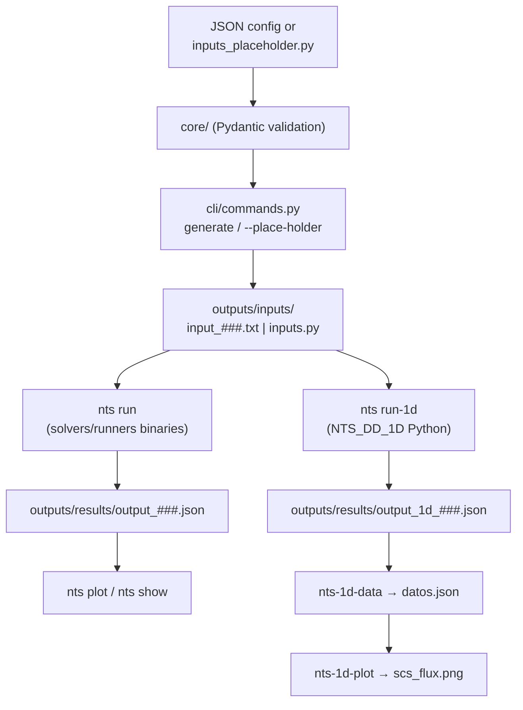

# Neutron Transport PINNs — NTS Automation System

[](Changelog_EN.md)

CLI automation system for **SN neutron transport simulations**:

- A **2D workflow** that drives a family of C solvers (`NTS_DD`, `NTS_LD`, `NTS_STEP`, `NTS_RM_CN`, `NTS_RM_LLN`) from JSON configurations.
- A **1D workflow** with a pure-Python Diamond Difference solver (`NTS_DD_1D`) used to generate training datasets for PINN models.
- Parametric sweeps via **placeholders**, parallel execution, and post-processing (data extraction + plotting).

## Table of Contents

- [Features](#-features)
- [Requirements](#-requirements)
- [Installation](#-installation)
- [CLI Reference](#-cli-reference)
- [2D Workflow (binaries)](#-2d-workflow-binary-solvers)
- [1D Workflow (Python solver)](#-1d-workflow-python-solver-nts_dd_1d)
- [Multiplicative Media (1D)](#multiplicative-media-1d)
- [Configuration Format](#-configuration-format)
- [Output Formats](#-output-formats)
- [Project Layout](#-project-layout)
- [Architecture](#-architecture)
- [Troubleshooting](#-troubleshooting)
- [Additional Documentation](#-additional-documentation)

## 🚀 Features

- **Automatic `input.txt` generation** from JSON configs with Pydantic validation (physical constraints enforced: `σs < σt`, even `N`, 1-based zone maps, …)
- **Parametric sweeps** via placeholders — generate hundreds of input variants from a single template
- **Parallel execution** of the 2D solvers with a configurable process pool
- **1D Python solver** (`NTS_DD_1D`) with Diamond Difference + SN quadrature, executed over all configs in one shot
- **1D multiplicative media** (`MODE=eigenvalue|fixed_k|driven`) with `k_eff`, power iteration and optional power normalization
- **1D manual or JSON configuration**: interactive `--manual` wizard or `--json` file, with the effective config embedded in the output
- **1D config generator**: `nts-1d-config` writes JSON with optional `kk`/`mm` placeholders, expandable via `nts-generate --json`
- **1D result plots**: scalar flux vs `x`, angular flux per direction on one axes, `k_history`, and legacy SCS plots
- **Post-processing**: scalar-flux extraction, SCS/NU_SIGF/k_eff-vs-flux plots, 2D MFLUX heatmaps
- **Structured logging** per simulation plus a global rotating log
- **5 solvers** with different numerical methods selectable from the CLI

## 📋 Requirements

- Python **3.14+** (the codebase uses PEP 758 exception syntax)
- [uv](https://docs.astral.sh/uv/) package manager
- Compiled NTS binaries in `solvers/runners/` (only for the 2D workflow; the 1D solver is pure Python)

## 🔧 Installation

```bash
# Create the virtualenv and install dependencies
uv sync

# Verify the installation
uv run nts status
```

`nts status` reports which solver binaries are present and how many inputs/results exist.

## 🖥 CLI Reference

Main entry point: `uv run nts <command>` (implemented in `main.py` → `cli/commands.py`).

| Command | Purpose |
|---------|---------|
| `nts status` | Show solver binary availability and file counts |
| `nts validate <config.json>` | Validate a JSON configuration (Pydantic) and print a summary |
| `nts generate <config.json>` [-p] [-o PATH] | Generate a numbered `input_###.txt` for the 2D solvers |
| `nts generate --place-holder NAME START END STEP [--json CONFIG] [-o OUT]` | Expand placeholders from `inputs_placeholder.py` or a JSON config → `.py`/`.json` |
| `nts-1d-config [-o config.json]` | Interactive 1D config generator; numeric fields accept `kk`/`mm` placeholders |
| `nts run [-s SOLVER] [-i input.txt ...] [-p N]` | Run 2D simulations in parallel → `output_###.json` |
| `nts run-1d [-c inputs.py \| --json config.json \| --manual] [-o output.json]` | Run the Python 1D solver from a file, JSON, or the interactive wizard |
| `nts list inputs\|outputs` | List generated inputs / results |
| `nts show <result.json>` | Show a result summary (STATUS, ITER, CPU) |
| `nts plot [-r result.json] [-o out.png] [--show]` | Plot the `MFLUX` heatmap of a 2D result |
| `nts-1d-plot -r output_1d.json [--kind scalar\|angular\|k-history] [--run ...]` | Plot 1D scalar/angular flux or `k_eff` history from a raw output |
| `nts-1d-plot -i datos.json [--x SCS\|NU_SIGF\|k_eff]` | Legacy SCS/NU_SIGF/k_eff vs flux from `datos.json` |
| `nts-test [-v] [--failfast] [-p PATTERN]` | Run the repository unittest suite |

Extra shortcuts (independent entry points, see `pyproject.toml`):

| Shortcut | Purpose |
|----------|---------|
| `nts-generate` | Placeholder expansion (`--place-holder`, `--json`, `-o`) |
| `nts-1d-config` | Interactive 1D config JSON generator (`-o` optional) |
| `nts-1d-run` | Same as `nts run-1d` (`-c`, `--json`, `--manual`) |
| `nts-test` | Run the unittest suite (`-v`, `--failfast`, `-p PATTERN`) |
| `nts-1d-data [--latest] [--positions 0 100] [--inputs inputs.py]` | Extract scalar fluxes + `NU_SIGF`/`mode`/`k_eff` (uses embedded config when available) |
| `nts-1d-plot -r output_1d.json [--kind scalar\|angular\|k-history] [--run ...]` | Scalar/angular flux or `k_history` from a raw output |
| `nts-1d-plot -i datos.json [--x SCS\|NU_SIGF\|k_eff]` | Legacy SCS/NU_SIGF/k_eff vs flux, one subplot per position |

## 🌀 2D Workflow (binary solvers)

### 1. Validate and generate inputs

```bash
uv run nts validate example_config.json
uv run nts generate example_config.json --preview
```

Generated files are auto-numbered in `outputs/inputs/input_001.txt`, `input_002.txt`, …

### 2. Run simulations

```bash
# All inputs with the default solver (NTS_DD), 4 parallel processes
uv run nts run --parallel 4

# Specific solver and inputs
uv run nts run -s NTS_RM_CN -i outputs/inputs/input_001.txt outputs/inputs/input_002.txt

# Available solvers
uv run nts run -s NTS_DD       # Domain Decomposition
uv run nts run -s NTS_LD       # Line Diffusion (fastest)
uv run nts run -s NTS_STEP     # Characteristic sweeps (beam sources)
uv run nts run -s NTS_RM_CN    # Response Matrix + Crank-Nicolson (most precise)
uv run nts run -s NTS_RM_LLN   # Response Matrix + Linear Lattice (assemblies)
```

Results are written to `outputs/results/output_###.json`.

### 3. Inspect and plot

```bash
uv run nts show outputs/results/output_001.json
uv run nts plot -r outputs/results/output_001.json --show
```

## 🧪 1D Workflow (Python solver, NTS_DD_1D)

The 1D solver solves the planar SN transport equation with Diamond Difference,
including reflected boundaries and multiplicative media (fission / `k_eff`),
and is orchestrated through Python config modules instead of text files.

### 1. Define the sweep template

Edit `outputs/inputs/inputs_placeholder.py` — write the placeholder value as a
bare variable name (a string in the dict):

```python
config_dict = {
    "num_regions": 1,
    "num_zones": 1,
    "NC": [100],
    "HR": [100],
    "IZL": [1],
    "SCT": [1.0],
    "SCS": [kk],   # placeholder
    "NU_SIGF": [0.0],
    "Q": [0],
    "N": 4,
    "reflex_izq": True,
    "reflex_der": False,
    "bound_left": [1, 1],
    "bound_right": [0, 0],
    "MODE": "fixed_source",
}
```

### 2. Expand placeholders

```bash
uv run nts-generate --place-holder kk 0.1 0.95 0.05

# Several placeholders are combined in parallel
uv run nts-generate --place-holder kk 0.1 0.95 0.05 --place-holder qq 0 2 1
```

This writes `outputs/inputs/inputs.py` with `config_dict_001`, `config_dict_002`, …
(one per combination), each validated with Pydantic when it is a full config.
Floats are rounded according to the number of decimals of `STEP`.

### 3. Run the 1D solver

```bash
uv run nts-1d-run
```

Produces `outputs/results/output_1d_###.json`:

```json
{
  "solver": "NTS_DD_1D",
  "runs": [
    {
      "config_name": "config_dict_001",
      "configuration": {"SCS": [0.9], "NU_SIGF": [0.11], "MODE": "eigenvalue"},
      "scalar_flux": [...],
      "angular_flux": [...],
      "iteration": 13,
      "converged": true,
      "mode": "eigenvalue",
      "k_eff": 1.026676,
      "k_balance": 1.026677,
      "k_history": [...],
      "k_converged": true,
      "outer_iterations": 25,
      "power_w": null,
      "power_scale": 1.0,
      "timestamp": "2026-06-01T19:02:59"
    }
  ]
}
```

### 4. Extract and plot

```bash
uv run nts-1d-data --latest --positions 0 50 100
uv run nts-1d-plot
```

- `nts-1d-data` merges each run with its source config and writes
  `outputs/results/datos.json` containing `SCS` (first zone) and
  `flux_<position>` for every requested position.
- `nts-1d-plot` reads `datos.json` and renders one subplot per position in
  `outputs/results/plots/scs_flux.png`.

### Generate a config JSON (with optional placeholders)

```bash
uv run nts-1d-config -o outputs/inputs/config_1d_001.json
```

- Without `-o`, it auto-numbers `outputs/inputs/config_1d_###.json`.
- Numeric fields accept a number **or** a placeholder name (`kk`, `mm`,
  ...), including the spatial fields `NC` (cells) and `HR` (thickness).
  `NC` must expand to positive integers; `HR` to positive floats.
  `N`, `IZL` and `MAX_OUTER` stay numeric.

```text
Celdas Región 1 (entero o placeholder, e.g. cc): cc
Espesor Región 1 (número o placeholder, e.g. hh): hh
```
- If the JSON contains placeholders, expand it before running:

```bash
uv run nts-generate --json outputs/inputs/config_1d_001.json \
  --place-holder kk 0.1 0.95 0.05 \
  --place-holder mm 0.05 0.20 0.05 \
  -o outputs/inputs/inputs_1d.json

uv run nts-1d-run --json outputs/inputs/inputs_1d.json
```

- `-o .py` writes `config_dict_###` (`inputs.py` format); `-o .json` writes
  a list of expanded configs.
- Placeholder ranges are combined in parallel by index (minimum length).
- Without `--json`, `nts-generate` still reads
  `outputs/inputs/inputs_placeholder.py` and writes `inputs.py`.

### Manual and JSON configuration

Besides a Python `inputs.py` file, the 1D runner accepts a single manual
configuration from the console or from JSON:

```bash
# Interactive step-by-step wizard (one run)
uv run nts-1d-run --manual

# One JSON object, or a list of objects
uv run nts-1d-run --json config.json
```

The wizard asks geometry, materials, quadrature, fission/`MODE`, `k_eff`,
tolerances, power normalization and boundary conditions, then prints a
summary and asks for confirmation. `--manual`, `--json` and `-c` are
mutually exclusive; `-o/--output` works in all three cases.

```json
{
  "num_regions": 1, "num_zones": 1,
  "NC": [100], "HR": [20.0], "IZL": [1],
  "SCT": [1.0], "SCS": [0.9],
  "NU_SIGF": [0.11],
  "Q": [0.0], "N": 8,
  "reflex_izq": false, "reflex_der": false,
  "bound_left": [0, 0, 0, 0], "bound_right": [0, 0, 0, 0],
  "MODE": "eigenvalue"
}
```

Each output run stores its effective `configuration`, so `nts-1d-data` and
`sweep_kpis.py` work for manual/JSON runs without `outputs/inputs/inputs.py`.

## Multiplicative Media (1D)

`NTS_DD_1D` solves the one-group S_N equations with isotropic scattering,
isotropic fission and an optional external source:

$$
\mu_m \frac{d\Psi_m}{dx} + \Sigma_t\Psi_m
= \frac12\left[\Sigma_s + \frac{\nu\Sigma_f}{k}\right]\Phi
+ \frac12 Q,
\qquad m=1,\dots,N
$$

with $\Phi=\sum_{m>0}w_m(\Psi_m^+ + \Psi_m^-)$.

`NU_SIGF` is **νΣf** in cm⁻¹. The `1/2` is already in the sweep, so do
**not** apply the `4π` convention used by the spectral tooling.

### Modes

| `MODE` | `NU_SIGF` | `K_EFF` | Source | Use |
|---|---|---|---|---|
| `fixed_source` | 0 | — | `Q` / incoming | Historical, no fission |
| `eigenvalue` | > 0 | — | none (`Q=0`) | Compute `k_eff` |
| `fixed_k` | > 0 | > 0 | optional | Imposed-k / parametric |
| `driven` | > 0 | 1 (fixed) | required | Physical source + fission |

- **`eigenvalue`**: homogeneous problem, computes `k_eff` by power
  iteration. Requires `Q=0` and zero incoming flux; vacuum and reflective
  boundaries are both allowed.
- **`driven`**: physical source problem. Fission is **not** divided by
  `k`; the flux amplitude is set by `Q`. Use it for a subcritical assembly
  with an external source.
- **`fixed_k`**: imposes `k` in the denominator. With a source it is a
  driven problem with scaled fission; without a source it is a mode-shape
  problem (the amplitude is arbitrary and `k_balance` reports the critical
  `k` of that shape).
- **`fixed_source`**: the historical no-fission mode.

`k_eff` and `k_balance` obey the global balance
`k = P/(A+L)`, with `P=∫νΣfΦdx`, `A=∫(Σt−Σs)Φdx` and `L` the net leakage.

### Example: 20 cm benchmark

Homogeneous 20 cm slab, vacuum on both sides, `σt=1.0`, `σs0=0.9`,
`νσf=0.11`:

```python
config_dict = {
    "num_regions": 1,
    "num_zones": 1,
    "NC": [100],
    "HR": [20.0],
    "IZL": [1],
    "SCT": [1.0],
    "SCS": [0.9],
    "NU_SIGF": [0.11],
    "Q": [0.0],
    "N": 8,
    "reflex_izq": False,
    "reflex_der": False,
    "bound_left": [0, 0, 0, 0],
    "bound_right": [0, 0, 0, 0],
    "MODE": "eigenvalue",
}
```

```bash
uv run nts-1d-run
```

Expected S8 result: `k_eff ≈ 1.02668` (S4 ≈ 1.02651, S2 ≈ 1.02464);
`k_inf = νΣf/(Σt−Σs) = 1.1`. The slab is slightly supercritical.

### Power normalization

If `POWER_KW` is set, the flux is rescaled after convergence so that

$$
P = A\,E_f\,(1.602176634\times10^{-13})
\int_0^L \Sigma_f\Phi\,dx,
$$

with `P` in W, `A` in cm², `E_f` in MeV/fission and `Σf` in cm⁻¹. Use
`SIGMA_F` per zone or `NU` (nu_bar) to convert `NU_SIGF` into `Σf`.
`E_F_MEV` defaults to 200 and `AREA_CM2` to 1. The normalization does not
change `k_eff`.

### Output

Each run in `output_1d_###.json` adds `mode`, `k_eff`, `k_balance`,
`k_history`, `k_converged`, `outer_iterations`, `power_w` and
`power_scale`. `nts-1d-data` propagates `NU_SIGF`, `mode`, `k_eff` and
`k_balance` to `datos.json`; `nts-1d-plot --x k_eff` (or
`--x NU_SIGF`) plots against the new variables.

### Plotting 1D results

`nts-1d-plot` now reads a raw `output_1d_*.json` (with `runs[]`) and plots:

```bash
# List the runs available in the file
uv run nts-1d-plot -r outputs/results/output_1d_016.json --list-runs

# Scalar flux vs x
uv run nts-1d-plot -r outputs/results/output_1d_016.json --kind scalar --run manual

# Angular flux vs x: one colored line per direction on the same axes
uv run nts-1d-plot -r outputs/results/output_1d_016.json --kind angular --run manual
uv run nts-1d-plot -r outputs/results/output_1d_016.json --kind angular --run manual --directions 0 1

# k_eff history (eigenvalue only)
uv run nts-1d-plot -r outputs/results/output_1d_016.json --kind k-history --run manual
```

- If the file has more than one run, `--run NAME|INDEX` is required;
  `--list-runs` shows the options. For `scalar`/`k-history`, `--run all`
  overlays all runs. For `angular`, exactly one run is required.
- `angular_flux` is stored as `ω_m(ψ⁺+ψ⁻)`; the y-axis label says so.
- `--kind k-history` only works for `MODE=eigenvalue`; other modes have no
  history.
- Default outputs: `outputs/results/plots/scalar_flux.png`,
  `angular_flux.png`, `k_history.png`.
- Legacy `datos.json` mode: `uv run nts-1d-plot -i outputs/results/datos.json --x k_eff`.

See [doc/MULTIPLICATIVE_MEDIA_EN.md](doc/MULTIPLICATIVE_MEDIA_EN.md) for the
full reference, algorithm, validation and pitfalls. The Spanish version is
[doc/MULTIPLICATIVE_MEDIA.md](doc/MULTIPLICATIVE_MEDIA.md). The 2D C solvers
remain fixed-source only.

## 📝 Configuration Format

See `templates/base_input.json` (2D, with `_comment` keys) and `example_config.json` (minimal 2D example).

### 2D format (`SimulationConfig`, Pydantic)

| Field | Meaning | Constraints |
|-------|---------|-------------|
| `N` | Quadrature order | Even, 2–18 |
| `NZ` | Number of material zones | ≥ 1 |
| `zones` | `{sigma_t, sigma_s}` per zone | `sigma_s < sigma_t` |
| `NR_X`, `XDOM` | X regions: `{"length": cm, "nodes": M}` | `len(XDOM) == NR_X` |
| `NR_Y`, `YDOM` | Y regions: `{"length": cm, "nodes": M}` | `len(YDOM) == NR_Y` |
| `ZMAP` | Zone map (NR_Y × NR_X) | Integers in `[1, NZ]` |
| `QMAP` | Source map (NR_Y × NR_X) | `≥ 0` |
| `BC` | Boundary conditions `[left, right, bottom, top]` | `0.0` (vacuum) or `1.0` (reflective) |
| `TOL` | Convergence tolerance | `1e-7 … 1e-2` |

### 1D format (`outputs/inputs/inputs.py` dicts)

| Field | Meaning |
|-------|---------|
| `num_regions`, `num_zones` | Region/zone counts |
| `NC` | Cells per region |
| `HR` | Region thicknesses |
| `IZL` | Zone index (1-based) per region |
| `SCT`, `SCS` | Total / scattering cross sections per zone |
| `NU_SIGF` | νΣf per zone [cm⁻¹]; 0 = no fission |
| `SIGMA_F` | Optional Σf per zone [cm⁻¹] (power normalization) |
| `Q` | Source per region |
| `N` | Quadrature order (2, 4, 6 or 8 have tabulated quadratures) |
| `reflex_izq`, `reflex_der` | Reflective boundary on left/right |
| `bound_left`, `bound_right` | Incoming flux per quadrature direction at each boundary (vectors of length N/2) |
| `MODE` | `fixed_source` (default), `eigenvalue`, `fixed_k` or `driven` |
| `K_EFF` | Imposed k; only `fixed_k` (`driven` forces 1) |
| `TOL_K`, `MAX_OUTER`, `K0` | Eigenvalue convergence controls |
| `POWER_KW`, `E_F_MEV`, `NU`, `AREA_CM2` | Optional power normalization |

## 📊 Output Formats

### 2D solvers (C binaries) — `outputs/results/output_###.json`

```json
{
  "STATUS": 0,
  "ITER": 20,
  "CPU": 0.002345,
  "MFLUX": [[...], [...]],
  "MFLOW": [[[...]], [[...]]],
  "XFLOW": [...],
  "YFLOW": [...]
}
```

### 1D solver — `outputs/results/output_1d_###.json`

See the example in the [1D workflow](#3-run-the-1d-solver) above.

### Extracted data — `outputs/results/datos.json`

```json
{
  "data": [
    {"source": "config_dict_001", "SCS": 0.1, "flux_0": 0.41, "flux_100": 0.09}
  ]
}
```

## 📁 Project Layout

```
neutron-transport-PINNs/
├── main.py                      # CLI entry point (uv run nts)
├── cli/                         # CLI plumbing
│   ├── commands.py              # All `nts` subcommands (argparse)
│   ├── run_1d.py                # Entry point: nts-1d-run
│   └── generate_placeholder.py  # Entry point: nts-generate
├── core/                        # Config generation and validation
│   ├── config.py                # Pydantic models (Zone, SimulationConfig)
│   ├── validator.py             # Validation helpers + summary
│   └── input_builder.py         # JSON config → 11-line solver input
├── execution/                   # Solver execution
│   ├── runner.py                # Single solver subprocess runner
│   └── parallel.py              # Multiprocessing pool runner
├── utils/                       # Shared utilities
│   ├── paths.py                 # Directory constants + solver registry
│   ├── logger.py                # Global + per-simulation loggers
│   ├── extract_1d_flux.py       # nts-1d-data: flux extraction
│   ├── generate_1d_config.py    # nts-1d-config: interactive JSON config
│   ├── plot_1d_flux.py          # nts-1d-plot: scalar/angular/k_history
│   └── plot_scs_flux.py         # legacy SCS vs flux plots
├── solvers/
│   ├── runners/                 # C binaries + sources + Python solver
│   │   ├── NTS_DD_1D.py         # 1D DD solver (fission, k_eff, power norm)
│   │   └── cuadraturas.py       # SN quadrature tables (N=2,4,6,8)
│   └── doc_solvers/             # Method-by-method EXPLICACION.md guides
├── tests/                       # unittest suite (1D multiplicative media)
├── templates/                   # base_input.json (annotated 2D template)
├── doc/                         # Project documentation & notes
│   ├── MULTIPLICATIVE_MEDIA_EN.md  # k_eff modes, benchmark and validation (English)
│   └── MULTIPLICATIVE_MEDIA.md     # Spanish version
├── outputs/                     # Generated artifacts (gitignored)
│   ├── inputs/                  # input_###.txt, inputs.py, inputs_placeholder.py
│   ├── results/                 # output_###.json, datos.json, plots/
│   └── logs/                    # nts_automation_*.log, simulation_*.log
└── extras/                      # Meeting notes and archived experiments
```

## 🧱 Architecture



Key details:

- **`core/config.py`** defines the Pydantic models; unknown keys starting with
  `_` are ignored, so `templates/base_input.json` carries inline comments.
- **Paths and solver names** are centralized in `utils/paths.py`
  (`AVAILABLE_SOLVERS`, gitignored `outputs/` tree).
- **`execution/runner.py`** runs `solver input.txt` via `subprocess` and the
  C solvers write their JSON directly to the redirect target.
- **The 1D solver** iterates source iterations (sweep → scalar flux →
  convergence check every 100 iterations) with default `epsilon=1e-5`,
  `max_iter=2000`; quadrature data lives in `solvers/runners/cuadraturas.py`.
  In `MODE=eigenvalue` it wraps the source iteration in a power iteration
  (outer loop over the fission source and `k_eff`) and updates
  `k_new = k·P_new/P_old`.

## 🐛 Troubleshooting

```bash
# Check available solvers
uv run nts status

# Detailed logs (console only shows WARNING+)
ls outputs/logs/nts_automation_*.log

# Per-simulation logs
cat outputs/logs/simulation_*.log
```

Common issues:

| Symptom | Fix |
|---------|-----|
| Solver "missing" in `nts status` | Rebuild the binaries (see `doc/NTS_DOCUMENTATION.md`) |
| `STATUS != 0` in result JSON | Check the 11-line input format and `doc/NTS_DOCUMENTATION.md` constraints |
| `nts-1d-data` finds no `SCS` | Make sure the config dicts in `inputs.py` define `SCS` |
| Placeholder variables error when loading `inputs.py` | Regenerate with `uv run nts-generate` |
| Validation errors on `ZMAP`/`QMAP` | `ZMAP` must be NR_Y × NR_X with zone indices in `[1, NZ]` |
| `MODE='eigenvalue'` errors with a source | Use `MODE='driven'` (k=1) or `fixed_k`; the eigenvalue is homogeneous |
| `MODE='fixed_k'` complains about `K_EFF` | Set `K_EFF > 0`, or use `MODE='eigenvalue'` to compute it |
| `k_eff` does not converge | Increase `MAX_OUTER`, tighten `TOL_K`, refine the mesh |
| `POWER_KW` fails | Provide `SIGMA_F` per zone or `NU`; the solver needs Σf |
| `--manual` finishes without running | Answer `s` to the final “¿Ejecutar?” prompt; `n` cancels |
| `--json` fails | The file must be a JSON object or a list of objects with the 1D keys |
| `nts-1d-data` says config not found | Use a run with embedded `configuration`, or pass the matching `--inputs` |
| `nts-1d-plot` says several runs | Use `--list-runs`, then `--run NAME` or `--run INDEX` |
| `--kind k-history` fails | Only `MODE=eigenvalue` stores `k_history` |
| `--kind angular` shape error | The output needs `configuration.NC`/`HR`; regenerate it with the current solver |
| `nts-1d-config` rejects `kk` | `N`/`IZL`/`MAX_OUTER` are integers; `NC`/`HR` accept placeholders (`NC` must expand to positive integers) |
| `nts-generate --json` says unresolved | Provide a `--place-holder` for every name; missing names fail 1D validation |
| `nts-1d-run` says “could not convert string to float” | The config still has placeholders; expand it with `nts-generate --json` first |

## 🧪 Tests

```bash
uv run nts-test                         # whole suite
uv run nts-test -v                      # verbose
uv run nts-test --failfast              # stop on first failure
uv run nts-test -p "test_plot_1d_flux.py"  # one file
```

`nts-test` uses `unittest` and discovers `tests/test_*.py` from the
repository root, so it works from any current directory.

All generated figures, tables and CLI messages use English labels. The main
documentation is available in English; the Spanish versions of the
multiplicative-media guide and the changelog are kept alongside them.

## 📚 Additional Documentation

| Document | Content |
|----------|---------|
| `doc/QUICKSTART.md` | One-page command cheatsheet |
| `doc/NTS_DOCUMENTATION.md` | Master reference for the 5 C programs (input format, method selection, performance) |
| `doc/MULTIPLICATIVE_MEDIA_EN.md` | 1D fission/`k_eff` modes, benchmark, power normalization, validation (English) |
| `doc/MULTIPLICATIVE_MEDIA.md` | Spanish version of the same guide |
| `doc/QUICK_REFERENCE.txt` | Compact printable reference for the C solvers |
| `doc/desc_EN.md` | Reference 1D problem definition (English) |
| `doc/desc.md` | Reference 1D problem definition (original) |
| `solvers/doc_solvers/*_EXPLICACION.md` | Detailed per-method guides (Spanish): DD, LD, STEP, RM_CN, RM_LLN |
| `doc/Notas_EN.md`, `doc/Notas_2daReunion_EN.md` | Working notes and meeting records (English) |
| `doc/Notas.md`, `doc/Notas_2daReunion.md`, `extras/` | Original Spanish notes |
| `doc/IMPLEMENTATION_SUMMARY.md` | Historical implementation summary (English) |
| `doc/FIXES_APPLIED_EN.md` | Applied fixes log (English) |
| `doc/FIXES_APPLIED.md` | Original Spanish fixes log |
| `Changelog_EN.md` | Version history (English) |
| `CHANGELOG.md` | Version history (Spanish) |

## 🙌 Help

```bash
uv run nts --help
uv run nts <command> --help
```

---

**Neutron Transport PINNs** — SN neutron transport automation for PINN dataset generation.
