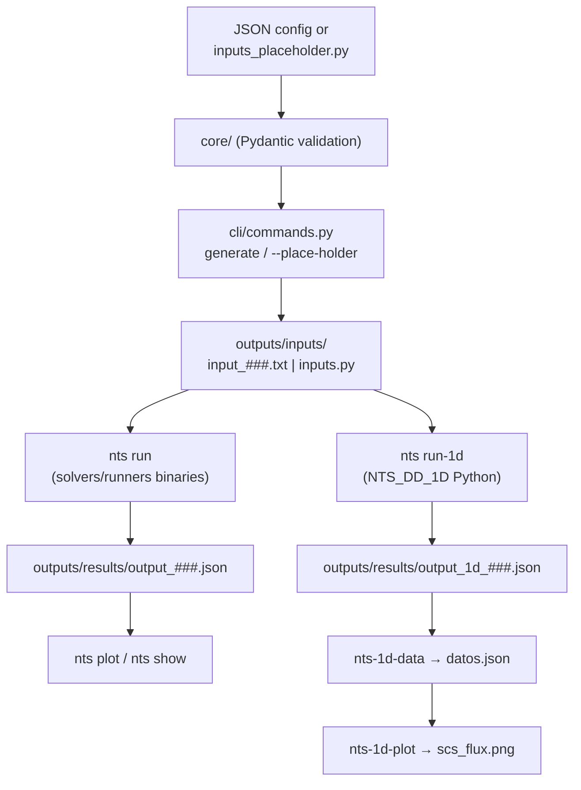

# Neutron Transport PINNs — NTS Automation System

[](CHANGELOG.md)

CLI automation system for **SN neutron transport simulations**:

- A **2D workflow** that drives a family of C solvers (`NTS_DD`, `NTS_LD`, `NTS_STEP`, `NTS_RM_CN`, `NTS_RM_LLN`) from JSON configurations.
- A **1D workflow** with a pure-Python Diamond Difference solver (`NTS_DD_1D`) used to generate training datasets for PINN models.
- Parametric sweeps via **placeholders**, parallel execution, and post-processing (data extraction + plotting).

## Table of Contents

- [Features](#-features)
- [Requirements](#-requirements)
- [Installation](#-installation)
- [CLI Reference](#-cli-reference)
- [2D Workflow (binaries)](#-2d-workflow-binary-solvers)
- [1D Workflow (Python solver)](#-1d-workflow-python-solver-nts_dd_1d)
- [Configuration Format](#-configuration-format)
- [Output Formats](#-output-formats)
- [Project Layout](#-project-layout)
- [Architecture](#-architecture)
- [Troubleshooting](#-troubleshooting)
- [Additional Documentation](#-additional-documentation)

## 🚀 Features

- **Automatic `input.txt` generation** from JSON configs with Pydantic validation (physical constraints enforced: `σs < σt`, even `N`, 1-based zone maps, …)
- **Parametric sweeps** via placeholders — generate hundreds of input variants from a single template
- **Parallel execution** of the 2D solvers with a configurable process pool
- **1D Python solver** (`NTS_DD_1D`) with Diamond Difference + SN quadrature, executed over all configs in one shot
- **Post-processing**: scalar-flux extraction, SCS-vs-flux plots, 2D MFLUX heatmaps
- **Structured logging** per simulation plus a global rotating log
- **5 solvers** with different numerical methods selectable from the CLI

## 📋 Requirements

- Python **3.14+** (the codebase uses PEP 758 exception syntax)
- [uv](https://docs.astral.sh/uv/) package manager
- Compiled NTS binaries in `solvers/runners/` (only for the 2D workflow; the 1D solver is pure Python)

## 🔧 Installation

```bash
# Create the virtualenv and install dependencies
uv sync

# Verify the installation
uv run nts status
```

`nts status` reports which solver binaries are present and how many inputs/results exist.

## 🖥 CLI Reference

Main entry point: `uv run nts <command>` (implemented in `main.py` → `cli/commands.py`).

| Command | Purpose |
|---------|---------|
| `nts status` | Show solver binary availability and file counts |
| `nts validate <config.json>` | Validate a JSON configuration (Pydantic) and print a summary |
| `nts generate <config.json>` [-p] [-o PATH] | Generate a numbered `input_###.txt` for the 2D solvers |
| `nts generate --place-holder NAME START END STEP` | Expand placeholders in `outputs/inputs/inputs_placeholder.py` → `inputs.py` |
| `nts run [-s SOLVER] [-i input.txt ...] [-p N]` | Run 2D simulations in parallel → `output_###.json` |
| `nts run-1d [-c inputs.py] [-o output.json]` | Run the Python 1D solver over all configs |
| `nts list inputs\|outputs` | List generated inputs / results |
| `nts show <result.json>` | Show a result summary (STATUS, ITER, CPU) |
| `nts plot [-r result.json] [-o out.png] [--show]` | Plot the `MFLUX` heatmap of a 2D result |

Extra shortcuts (independent entry points, see `pyproject.toml`):

| Shortcut | Purpose |
|----------|---------|
| `nts-generate` | Placeholder expansion (same flags as above) |
| `nts-1d-run` | Same as `nts run-1d` |
| `nts-1d-data [--latest] [--positions 0 100]` | Extract scalar fluxes → `outputs/results/datos.json` |
| `nts-1d-plot [-i datos.json] [-o plot.png]` | Plot SCS vs scalar flux, one subplot per position |

## 🌀 2D Workflow (binary solvers)

### 1. Validate and generate inputs

```bash
uv run nts validate example_config.json
uv run nts generate example_config.json --preview
```

Generated files are auto-numbered in `outputs/inputs/input_001.txt`, `input_002.txt`, …

### 2. Run simulations

```bash
# All inputs with the default solver (NTS_DD), 4 parallel processes
uv run nts run --parallel 4

# Specific solver and inputs
uv run nts run -s NTS_RM_CN -i outputs/inputs/input_001.txt outputs/inputs/input_002.txt

# Available solvers
uv run nts run -s NTS_DD       # Domain Decomposition
uv run nts run -s NTS_LD       # Line Diffusion (fastest)
uv run nts run -s NTS_STEP     # Characteristic sweeps (beam sources)
uv run nts run -s NTS_RM_CN    # Response Matrix + Crank-Nicolson (most precise)
uv run nts run -s NTS_RM_LLN   # Response Matrix + Linear Lattice (assemblies)
```

Results are written to `outputs/results/output_###.json`.

### 3. Inspect and plot

```bash
uv run nts show outputs/results/output_001.json
uv run nts plot -r outputs/results/output_001.json --show
```

## 🧪 1D Workflow (Python solver, NTS_DD_1D)

The 1D solver solves the planar SN transport equation with Diamond Difference,
including reflected boundaries, and is orchestated through Python config
modules instead of text files.

### 1. Define the sweep template

Edit `outputs/inputs/inputs_placeholder.py` — write the placeholder value as a
bare variable name (a string in the dict):

```python
config_dict = {
    "num_regions": 1,
    "num_zones": 1,
    "NC": [100],
    "HR": [100],
    "IZL": [1],
    "SCT": [1.0],
    "SCS": [kk],   # placeholder
    "Q": [0],
    "N": 4,
    "reflex_izq": [1],
    "reflex_der": [0],
    "bound_left": [1],
    "bound_right": [0],
}
```

### 2. Expand placeholders

```bash
uv run nts-generate --place-holder kk 0.1 0.95 0.05

# Several placeholders are combined in parallel
uv run nts-generate --place-holder kk 0.1 0.95 0.05 --place-holder qq 0 2 1
```

This writes `outputs/inputs/inputs.py` with `config_dict_001`, `config_dict_002`, …
(one per combination), each validated with Pydantic when it is a full config.
Floats are rounded according to the number of decimals of `STEP`.

### 3. Run the 1D solver

```bash
uv run nts-1d-run
```

Produces `outputs/results/output_1d_###.json`:

```json
{
  "solver": "NTS_DD_1D",
  "runs": [
    {
      "config_name": "config_dict_001",
      "scalar_flux": [...],
      "angular_flux": [...],
      "iteration": 13,
      "converged": true,
      "timestamp": "2026-06-01T19:02:59"
    }
  ]
}
```

### 4. Extract and plot

```bash
uv run nts-1d-data --latest --positions 0 50 100
uv run nts-1d-plot
```

- `nts-1d-data` merges each run with its source config and writes
  `outputs/results/datos.json` containing `SCS` (first zone) and
  `flux_<position>` for every requested position.
- `nts-1d-plot` reads `datos.json` and renders one subplot per position in
  `outputs/results/plots/scs_flux.png`.

## 📝 Configuration Format

See `templates/base_input.json` (2D, with `_comment` keys) and `example_config.json` (minimal 2D example).

### 2D format (`SimulationConfig`, Pydantic)

| Field | Meaning | Constraints |
|-------|---------|-------------|
| `N` | Quadrature order | Even, 2–18 |
| `NZ` | Number of material zones | ≥ 1 |
| `zones` | `{sigma_t, sigma_s}` per zone | `sigma_s < sigma_t` |
| `NR_X`, `XDOM` | X regions: `{"length": cm, "nodes": M}` | `len(XDOM) == NR_X` |
| `NR_Y`, `YDOM` | Y regions: `{"length": cm, "nodes": M}` | `len(YDOM) == NR_Y` |
| `ZMAP` | Zone map (NR_Y × NR_X) | Integers in `[1, NZ]` |
| `QMAP` | Source map (NR_Y × NR_X) | `≥ 0` |
| `BC` | Boundary conditions `[left, right, bottom, top]` | `0.0` (vacuum) or `1.0` (reflective) |
| `TOL` | Convergence tolerance | `1e-7 … 1e-2` |

### 1D format (`outputs/inputs/inputs.py` dicts)

| Field | Meaning |
|-------|---------|
| `num_regions`, `num_zones` | Region/zone counts |
| `NC` | Cells per region |
| `HR` | Region thicknesses |
| `IZL` | Zone index (1-based) per region |
| `SCT`, `SCS` | Total / scattering cross sections per zone |
| `Q` | Source per region |
| `N` | Quadrature order (2, 4 or 8 have tabulated quadratures) |
| `reflex_izq`, `reflex_der` | Reflective boundary on left/right |
| `bound_left`, `bound_right` | Incoming flux per quadrature direction at each boundary (vectors of length N/2) |

## 📊 Output Formats

### 2D solvers (C binaries) — `outputs/results/output_###.json`

```json
{
  "STATUS": 0,
  "ITER": 20,
  "CPU": 0.002345,
  "MFLUX": [[...], [...]],
  "MFLOW": [[[...]], [[...]]],
  "XFLOW": [...],
  "YFLOW": [...]
}
```

### 1D solver — `outputs/results/output_1d_###.json`

See the example in the [1D workflow](#3-run-the-1d-solver) above.

### Extracted data — `outputs/results/datos.json`

```json
{
  "data": [
    {"source": "config_dict_001", "SCS": 0.1, "flux_0": 0.41, "flux_100": 0.09}
  ]
}
```

## 📁 Project Layout

```
neutron-transport-PINNs/
├── main.py                      # CLI entry point (uv run nts)
├── cli/                         # CLI plumbing
│   ├── commands.py              # All `nts` subcommands (argparse)
│   ├── run_1d.py                # Entry point: nts-1d-run
│   └── generate_placeholder.py  # Entry point: nts-generate
├── core/                        # Config generation and validation
│   ├── config.py                # Pydantic models (Zone, SimulationConfig)
│   ├── validator.py             # Validation helpers + summary
│   └── input_builder.py         # JSON config → 11-line solver input
├── execution/                   # Solver execution
│   ├── runner.py                # Single solver subprocess runner
│   └── parallel.py              # Multiprocessing pool runner
├── utils/                       # Shared utilities
│   ├── paths.py                 # Directory constants + solver registry
│   ├── logger.py                # Global + per-simulation loggers
│   ├── extract_1d_flux.py       # nts-1d-data: flux extraction
│   └── plot_scs_flux.py         # nts-1d-plot: SCS vs flux plots
├── solvers/
│   ├── runners/                 # C binaries + sources + Python solver
│   │   ├── NTS_DD_1D.py         # 1D Diamond Difference solver
│   │   └── cuadraturas.py       # SN quadrature tables (N=2,4,8)
│   └── doc_solvers/             # Method-by-method EXPLICACION.md guides
├── templates/                   # base_input.json (annotated 2D template)
├── doc/                         # Project documentation & notes
├── outputs/                     # Generated artifacts (gitignored)
│   ├── inputs/                  # input_###.txt, inputs.py, inputs_placeholder.py
│   ├── results/                 # output_###.json, datos.json, plots/
│   └── logs/                    # nts_automation_*.log, simulation_*.log
└── extras/                      # Meeting notes and archived experiments
```

## 🧱 Architecture



Key details:

- **`core/config.py`** defines the Pydantic models; unknown keys starting with
  `_` are ignored, so `templates/base_input.json` carries inline comments.
- **Paths and solver names** are centralized in `utils/paths.py`
  (`AVAILABLE_SOLVERS`, gitignored `outputs/` tree).
- **`execution/runner.py`** runs `solver input.txt` via `subprocess` and the
  C solvers write their JSON directly to the redirect target.
- **The 1D solver** iterates source iterations (sweep → scalar flux →
  convergence check every 100 iterations) with default `epsilon=1e-5`,
  `max_iter=2000`; quadrature data lives in `solvers/runners/cuadraturas.py`.

## 🐛 Troubleshooting

```bash
# Check available solvers
uv run nts status

# Detailed logs (console only shows WARNING+)
ls outputs/logs/nts_automation_*.log

# Per-simulation logs
cat outputs/logs/simulation_*.log
```

Common issues:

| Symptom | Fix |
|---------|-----|
| Solver "missing" in `nts status` | Rebuild the binaries (see `doc/NTS_DOCUMENTATION.md`) |
| `STATUS != 0` in result JSON | Check the 11-line input format and `doc/NTS_DOCUMENTATION.md` constraints |
| `nts-1d-data` finds no `SCS` | Make sure the config dicts in `inputs.py` define `SCS` |
| Placeholder variables error when loading `inputs.py` | Regenerate with `uv run nts-generate` |
| Validation errors on `ZMAP`/`QMAP` | `ZMAP` must be NR_Y × NR_X with zone indices in `[1, NZ]` |

## 📚 Additional Documentation

| Document | Content |
|----------|---------|
| `doc/QUICKSTART.md` | One-page command cheatsheet |
| `doc/NTS_DOCUMENTATION.md` | Master reference for the 5 C programs (input format, method selection, performance) |
| `doc/QUICK_REFERENCE.txt` | Compact printable reference for the C solvers |
| `doc/desc.md` | Reference 1D problem definition (S2 benchmark dataset) |
| `solvers/doc_solvers/*_EXPLICACION.md` | Detailed per-method guides (Spanish): DD, LD, STEP, RM_CN, RM_LLN |
| `doc/Notas.md`, `doc/Notas_2daReunion.md`, `extras/` | Working notes and meeting records |
| `doc/IMPLEMENTATION_SUMMARY.md`, `doc/FIXES_APPLIED.md` | Historical implementation/correction log |
| `CHANGELOG.md` | Version history |

## 🙌 Help

```bash
uv run nts --help
uv run nts <command> --help
```

---

**Neutron Transport PINNs** — SN neutron transport automation for PINN dataset generation.
